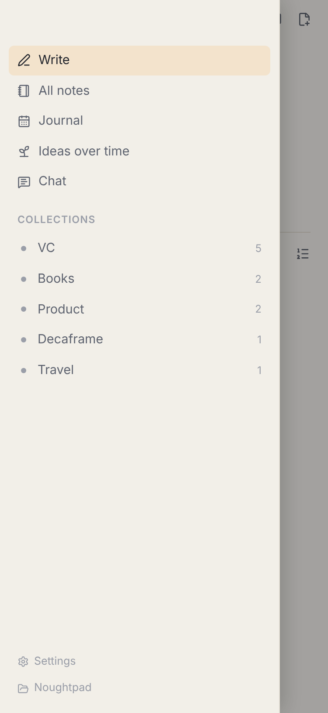
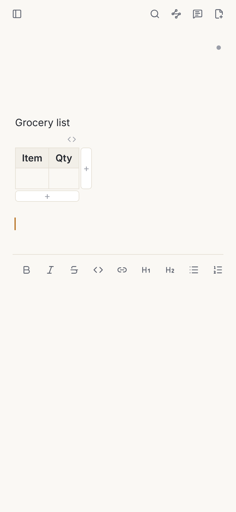

# Mobile (M7): plan and status

Noughtpad on iOS and Android, built with Tauri 2's mobile targets, reusing the same React UI
(`src/`) and the same Rust core (`crates/noughtpad-core`) as the desktop app. Mobile and Sync
(M6) are meant to be paid together; the core notebook (local notes, search, related notes)
stays free and FSL, same as desktop.

Read `ROADMAP.md` (M7) for the one-line slice list and `docs/DESIGN.md` for why the app is built
the way it is. This document is the detail behind that roadmap entry.

## What the mobile app is

Same product, same promise: a blank page that quietly remembers. On a phone that means:

- **Opens to a blank page.** No folder picker, no "which notebook" screen on first launch — the
  app opens straight into a new note, same as pressing ⌘⇧Space does on desktop.
- **Labels and source stay on demand.** The same `MetaStrip` component, invisible until you tap
  into it, exactly as on desktop.
- **Quick capture** is a later addition once the scaffolding works: a share-sheet target (iOS) or
  share intent (Android) that opens straight to a new note, and later a home-screen widget. Not
  in this first slice.
- **No AI during capture.** Same as desktop: indexing and embedding happen in the background,
  never on the typing path.

## What's reused, and what's desktop-only

**Reused as-is:**

- `crates/noughtpad-core`: vault, SQLite index, FTS5, embeddings (BGE-small), related notes,
  themes, chat context scopes. No mobile-specific changes needed; it already only touches the
  filesystem and SQLite.
- `src/`: the whole React UI — editor, live preview, slash menu, tables, images, journal, ideas,
  chat, settings. The same components render on a phone-sized viewport (see "Phone layout"
  below); nothing is forked into a separate mobile UI.
- `noughtpad-llm`'s `remote` feature (bring-your-own provider chat via the `genai` crate) and
  `keychain` feature (iOS Keychain, Android Keystore — `keyring` already supports both).
- Noughtpad Sync (M6): the Google Drive backend is plain HTTPS and OAuth with a loopback/PKCE
  flow; nothing in it is desktop-specific. It plugs in at build time exactly as it does on
  desktop (`pnpm sync`), against the same open `SyncBackend` interface.

**Desktop-only, switched off on mobile** (see "Scaffolding" below for how):

- Window lifecycle (`lifecycle.rs`): hide-on-close, reopen from the Dock, "Open at login". Phones
  don't have a window to hide or a login item.
- The macOS menu bar (`menu.rs`).
- Auto-update (`updater.rs`, `tauri-plugin-updater`). App Store / Play Store review handles
  updates on mobile; wiring that up is a distribution-time decision, not part of this slice.
- The global quick-capture shortcut (`tauri-plugin-global-shortcut`) and the single-instance
  guard (`tauri-plugin-single-instance`) — both meaningless on mobile, where the OS owns
  foreground/background and there's only ever one instance.
- Reading a pasted image off the system clipboard with `arboard` (desktop clipboard APIs only).
  Mobile paste still works through the browser's own `paste` event with files/items, which is
  the primary path on desktop too.
- **Local LLMs** (mistral.rs via `noughtpad-llm`'s `local`/`local-metal`/`local-cuda` features).
  See "Local AI on mobile" below.
- The notebook folder picker (`tauri-plugin-dialog`'s folder dialog) and `NOUGHTPAD_VAULT` (an
  env var for dev builds). Both are desktop ideas about choosing *where* your notes live; mobile
  always uses the one fixed location below, at least for this slice.

## Where notes live

Each platform's own convention for "files the user can get to without a computer":

| Platform | Location | Visible to the user? |
|---|---|---|
| macOS/Windows/Linux | User-chosen folder (default `~/Documents/Noughtpad`) | Yes, any file manager |
| iOS | The app's `Documents` directory (`NSDocumentDirectory`), via Tauri's `app.path().document_dir()` | Yes, in the **Files** app, under "On My iPhone/iPad → Noughtpad", once the app turns on `UIFileSharingEnabled` and `LSSupportsOpeningDocumentsInPlace` in `Info.plist` (done in the Xcode project generated by `tauri ios init`, see "Scaffolding") |
| Android | The app's external files directory (`getExternalFilesDir(null)`), via Tauri's `app.path().document_dir()` | Yes, but less conveniently: under `Android/data/app.noughtpad.desktop/files` in a file manager that shows internal storage (e.g. "Files by Google"); not every OEM file manager surfaces it by default |

Mobile has no folder picker and no `NOUGHTPAD_VAULT` override (see above): the vault backend
(`vault_info` in `src-tauri/src/lib.rs`) activates this fixed path automatically on first launch,
instead of showing the desktop "choose a folder" screen. There is nothing to configure in
Settings either; the "Switch folder" control is hidden on mobile (`VaultInfo.canSwitchVault`).

This is a deliberate v1 simplification, not a final answer. Obsidian's iOS app has the same
"Files app" visibility and the same rough edge on Android; a cleaner Android story (prompting for
a user-chosen SAF tree URI) is Backlog, not blocking this slice. It matters less than it would
without Sync, since M6 Google Drive sync means the phone's copy is never the only copy.

## How sync fits

Unchanged from M6: the same `SyncBackend` interface, the same Google Drive backend, the same
three-way merge engine (`pdmesh/noughtpad-sync`, linked in at build time exactly as desktop does
with `pnpm sync`). A phone is just another device with its own device id (`Device::load_or_create`
already uses `app.path().app_data_dir()`, which exists on mobile). iCloud sync stays Apple-only
and still needs the signing decision from M6; Google Drive is the backend for Android and for
iOS until then.

The OAuth sign-in flow (PKCE + loopback redirect) needs checking on mobile specifically: a mobile
OS may not let the app listen on a local port the way a desktop loopback redirect does. This is
flagged as an open risk for the sync slice, not solved here — M7's first slices are scaffolding
and layout, not sync.

## Search, related notes and chat on device

- **Search and related notes**: BGE-small (the same `embedding-static` build of `noughtpad-core`)
  is small enough to run on a phone — about 65 MB, CPU-only, already capped at half the device's
  cores. No change to the algorithm; the open question is purely build-time (see "Open risks"
  below): whether `fastembed`'s ONNX Runtime download has prebuilt Android/iOS binaries, or
  whether mobile needs `embedding-dynamic` with a bundled `onnxruntime` instead.
- **Chat**: through the user's own provider only (`noughtpad-llm`'s `remote` feature — Anthropic,
  OpenAI, Gemini, Ollama on the same network, or any OpenAI-compatible endpoint). Exactly the
  same privacy rules as desktop: nothing leaves the phone until a provider is chosen and the
  chat's scope is approved.
- **Local LLMs stay off mobile for now.** mistral.rs (`noughtpad-llm`'s `local` feature) and
  `local-llm-metal` are desktop/Metal-specific and are not part of the mobile build's feature set
  (see "Scaffolding"). This is a build-time exclusion, not a product decision carved in stone —
  see "Local AI on mobile" for what a later experiment could look like.

## Local AI on mobile (what's actually available, if we want it later)

The task of picking the mobile feature set raised the obvious question: phones increasingly ship
their *own* on-device models, separate from anything Noughtpad would bundle. Worth knowing about,
not worth building against yet:

- **Apple (iOS 18+ / Apple Intelligence, "Foundation Models" framework, 2026 SDKs):** a small
  on-device Apple LLM is callable in-process by any app that links the framework, for
  summarisation/rewriting-style tasks, with no network call and no user API key. Attractive for
  Noughtpad's "narrate these signals" use (DESIGN §6.4) if it ever ships beyond chat — but it is
  Apple-only, needs a supported device/OS version, and (like iCloud) needs the Developer Program
  signing Noughtpad doesn't have yet. Not pursued now.
- **Android (Gemini Nano via ML Kit's GenAI APIs / AICore):** a similar small on-device model,
  callable from an Android app without a key, on supported devices (recent flagship-tier
  hardware; availability is inconsistent across OEMs and Android versions as of this writing).
  Same shape of opportunity as Apple's, same caveat about being one OS's feature, not a portable
  Tauri/Rust API — it would need a thin Kotlin/JNI bridge, same pattern used for "the webview
  hands over a paste with nothing in it" today (see `paste_clipboard_image`'s desktop-only
  `arboard` call, which is exactly the kind of native escape hatch this would need).
- **mistral.rs on a phone directly:** technically possible (it's plain Rust, no GPU required for
  CPU inference) but a 2.5 GB download and the RAM/thermal budget of a background note app make
  it a bad fit for now; this is the "local LLMs are a later experiment" line in `ROADMAP.md`.

None of this blocks M7. If it's picked up later, it's additive (a third chat tier, "this
device's own model", alongside local-on-desktop and bring-your-own), gated behind its own
platform-specific feature, same pattern as `local-llm-metal`.

## Scaffolding: what actually changed in the repo

- `src-tauri/src/lib.rs`: the mobile entry point (`#[cfg_attr(mobile, tauri::mobile_entry_point)]`
  on `run()`) and the plugin wiring for window lifecycle, global shortcut, updater, autostart and
  single-instance are gated with `#[cfg(desktop)]` (they already were, mostly, before this
  slice — see "What was already in place"). `default_vault_path()` now takes the `AppHandle` and
  asks Tauri's own path resolver (`app.path().document_dir()`) instead of the `dirs` crate, which
  doesn't resolve a documents folder on mobile. On mobile, `vault_info()` activates that path
  automatically instead of returning `None` (which would show the desktop "choose a folder"
  screen). `VaultInfo` carries a new `canSwitchVault` flag (`cfg!(desktop)`) so the frontend can
  hide folder-switching controls on mobile without needing its own platform check.
- `src-tauri/Cargo.toml`: desktop-only crates (`tauri-plugin-autostart`, `tauri-plugin-global-shortcut`,
  `tauri-plugin-updater`, `tauri-plugin-single-instance`, `arboard`, `png`) are already under
  `[target.'cfg(not(any(target_os = "android", target_os = "ios")))'.dependencies]`, so a mobile
  build simply never compiles them in. Mobile builds pass
  `--no-default-features --features embedding-static` (see `package.json`'s `tauri:android:*`
  scripts) so `local-llm` (mistral.rs) is never part of the mobile binary; this is the build-time
  version of "local LLMs stay off mobile for now" above.
- `src-tauri/tauri.conf.json`: unchanged identifier and window config (desktop keeps its
  1100×800 default window; mobile ignores window size entirely and always fills the screen).
- `src-tauri/gen/android` and `src-tauri/gen/apple` are **not in this PR** — see "Status" below
  for why, and the exact commands to generate and commit them yourself. Once generated, Tauri
  expects them checked in and edited directly (they're real Xcode/Gradle projects, not throwaway
  scaffolding) for anything `tauri.conf.json` can't express, like `Info.plist`'s file-sharing
  flags mentioned above.
- `src/`: see "Phone layout" below.

### What was already in place

Worth noting plainly: a surprising amount of the "switch off desktop-only code" work was already
done before this slice, apparently in anticipation of mobile — `lib.rs` already had
`#[cfg(desktop)]` around the window-lifecycle/updater/global-shortcut/single-instance plugin
registrations and `#[cfg(mobile)]` around the clipboard-image fallback, and `Cargo.toml` already
separated those plugins into a non-mobile target dependency block. This slice's Rust changes were
smaller than expected as a result: mainly the vault-path and `vault_info()` mobile branch, plus
verifying (rather than building from scratch) the existing gating.

## Phone layout

- The sidebar becomes a drawer below 680px of viewport width: hidden by default, opened with the
  same sidebar toggle button that pins/unpins it on desktop, as a full-height overlay with a
  tap-to-dismiss backdrop, closing itself once you pick something from it.
- The top bar and the note header's right-hand controls (date, save dot, trash) are hover-reveal
  on desktop (`chrome-auto`); below 680px they're always shown, since there's no hover to reveal
  them. Same for the rich-block hover tools (image zoom, code copy, table add-row/add-column) —
  on a coarse pointer (`@media (pointer: coarse)`), which covers a real touchscreen regardless of
  viewport width, they're always visible rather than hidden until `:hover`.
- The note column already has a `max-width` and centres itself; at 375px it's simply the full
  width minus padding, same as any narrow desktop window.
- **Tap alternative for the right-click menu:** `nativeContextMenu()` (Tauri's native `Menu` popup
  — format/paragraph/insert submenus, cut/copy/paste) is skipped on a coarse pointer. Two things
  take its place: the browser/webview's own text-selection toolbar still appears on a selection
  (Copy/Paste, etc. — we simply stop intercepting `contextmenu` to replace it), and a new sticky
  **format toolbar** (`src/components/FormatToolbar.tsx`) appears above the on-screen keyboard
  while writing, with Bold/Italic/Strikethrough/Code/Link, the heading/list/quote paragraph
  types, and Table/Image/Divider/Code block/Diagram inserts — the same `COMMANDS` list
  (`src/editor/commands.ts`) the slash menu and keyboard shortcuts already use, so there's one
  source of truth for what a command does, not three.
- **Tap alternative for hover-only widget tools:** covered above (always visible on coarse
  pointer).
- The slash menu (`/`) already works by typing, so it needed no change — it's the one "hover-only"
  surface that was never actually hover-only.

Screenshots at 375×812 (iPhone-width, with touch emulation) against the mock backend, also
attached to the PR:

| Blank write page | Sidebar drawer open | A note with a table |
|---|---|---|
|  |  |  |

The first shows the format toolbar (the right-click menu's tap alternative) and the always-shown
"Add label"/"Add source" row. The second shows the drawer over a dimmed backdrop, opened from the
same button that pins/unpins the sidebar on desktop. The third shows a table's add-row/add-column
and `</>` controls, which are hover-only on desktop, always visible here.

## The slices, in order

1. **Scaffolding** — mobile entry point, desktop-only code switched off, `tauri android/ios init`
   committed, desktop build and CI unaffected.
   *Exit: `cargo check` and `pnpm typecheck`/`pnpm test`/`pnpm perf` still green on desktop, and
   the mobile targets are at least initialised (see "Status" below for what actually ran in this
   environment, which turned out to be less than the full exit criterion).*
2. **Phone layout** — drawer sidebar, 375px note page, tap alternatives for hover tools and the
   right-click menu.
   *Exit: the UI is fully usable with a mouse pretending to be a finger at 375×812, checked with
   screenshots against the mock backend.*
3. **Runs on a real device** — an installable debug build on both platforms.
   *Exit: a debug APK installs and opens to a blank page on an Android device/emulator; the Xcode
   project builds and runs on the user's Mac and a real iPhone or the Simulator.*
4. **Capture from outside the app** — share-sheet/share-intent quick capture, matching desktop's
   ⌘⇧Space.
   *Exit: sharing a URL or text from another app creates a Noughtpad note with that content.*
5. **Sync checked on a phone** — M6 Google Drive sync exercised on a real device alongside the
   existing two Macs.
   *Exit: an edit on the phone reaches a Mac and back within the same timing as two Macs today.*
6. **A home-screen widget** (quick capture without opening the app) — later still; needs its own
   native (WidgetKit / Android App Widget) code behind the same vault.
7. **Store listings and paid unlock** — tied to M6's licensing/billing work, not mobile-specific.

This document gets updated as each slice lands; `ROADMAP.md`'s M7 section stays the one-line
summary, this stays the detail.

## Status (2026-11-05)

- **Slice 1 (scaffolding):** the Rust/Cargo changes (mobile entry point, `default_vault_path`
  via Tauri's path resolver, `vault_info()`'s mobile branch, `VaultInfo.canSwitchVault`) are done
  and reviewed by eye, but **not compiled for a mobile target in this environment** — see
  "Android, in this environment" just below for why. Desktop `cargo fmt`/`clippy`/tests and
  `pnpm typecheck`/`test`/`perf` were checked green after the changes (see HANDOFF for the exact
  run). `tauri android init` and `tauri ios init` were **not run**, so `src-tauri/gen/android`
  and `src-tauri/gen/apple` are not in this PR; see below for the commands to generate them.
- **Slice 2 (phone layout):** done for the write page, sidebar and editor, checked with
  screenshots at 375×812 against the mock backend (attached to the PR). Not yet checked on the
  Journal, Ideas, Chat or Settings pages at that width (Backlog item below).
- **Slice 3 (runs on a device):** not reached. See below.
- Slices 4–7: not started.

### Android, in this environment: blocked on network access, not attempted further

This cloud session's network policy refuses `dl.google.com` (confirmed: `curl` to it was denied
by the egress proxy with "connect_rejected... not allowed for this session"), which is where
`tauri android init` downloads the Android SDK command-line tools from on first use, and there's
no apt package that substitutes for it. So:

- `pnpm tauri android init` fails at its own SDK-presence check before generating anything —
  there is no partial `src-tauri/gen/android` to commit.
- Rust's `aarch64-linux-android` (and the other three Android) targets *were* installable via
  `rustup target add` (that pulls from `static.rust-lang.org`, which this session's network
  policy does allow) and are left installed, but even `cargo check --target aarch64-linux-android`
  fails without the Android NDK's C compiler — several dependencies down the chain (`aws-lc-sys`,
  pulled in through `rusqlite`/`ureq`/`genai`'s TLS stack) compile C and assembly in their
  `build.rs`, which needs `aarch64-linux-android-clang` from the NDK. So nothing about the mobile
  Rust code in this PR has been compiled, only read and reasoned about; it may have mistakes a
  real build would catch.
- No debug APK was built, and none of this document's claims about Android should be read as
  "verified" until someone with a normal network runs it.

**To actually try this**, either widen this cloud environment's network access (the session's
network policy is a project/environment setting — *Environment → Network access*, add
`dl.google.com` and the other Android SDK/Maven hosts, or switch off the restrictive policy) and
re-run this slice, or do it locally:

```sh
# Needs Android Studio (or just its command-line tools) and a JDK; see
# https://tauri.app/start/prerequisites/#android for the exact versions Tauri expects.
export ANDROID_HOME="$HOME/Android/Sdk"   # wherever you installed it
export NDK_HOME="$ANDROID_HOME/ndk/<version>"
pnpm install
pnpm tauri android init
# Builds a debug APK excluding local-llm (see "Scaffolding" above for why):
pnpm tauri android build --debug --no-default-features --features embedding-static
```

Worth adding an npm script (`tauri:android:build` or similar) for that feature-flag combination
once this has actually been run once; not added speculatively here since it's unverified.

### Building and running on iOS (do this on your Mac, not in this environment)

This environment is Linux, and Tauri's iOS tooling (`tauri ios init`, Xcode project generation)
only runs on macOS with Xcode installed — there was no attempt to work around that; it's a hard
requirement, not a network or SDK question like Android's. Everything below is to be run on your
Mac, and `tauri ios init` hasn't been run anywhere yet, so the first step there is really the
start of this slice, not a resumption of it.

Requirements: a Mac with Xcode installed (the current version from the App Store), the Xcode
command-line tools (`xcode-select --install`), and Rust's iOS targets.

```sh
# Once, on your Mac:
rustup target add aarch64-apple-ios aarch64-apple-ios-sim x86_64-apple-ios
xcode-select --install   # if you haven't already

# From the repo root:
pnpm install
pnpm tauri ios init       # only if src-tauri/gen/apple isn't already checked out/up to date
pnpm tauri ios dev        # opens the Xcode project and launches it in the Simulator
```

To run on a real iPhone instead of the Simulator: open `src-tauri/gen/apple/noughtpad.xcodeproj`
in Xcode, sign in with your Apple ID under Xcode → Settings → Accounts (a free personal team
works for a 7-day on-device install; no paid Developer Program needed just to run a debug build
on your own phone), select your iPhone as the run destination, and press Run. This is separate
from the Apple Developer Program membership that's still deferred for desktop signing/notarising
and for iCloud — a free personal team is enough to put a debug build on your own device, just not
to distribute it or use entitlements like iCloud.

If `pnpm tauri ios dev` fails to find a local model runtime or sync, that's expected: mobile
builds exclude `local-llm` deliberately (see "Scaffolding"), and sync only links in through
`pnpm sync` same as desktop, which needs `pdmesh/noughtpad-sync` checked out next to this repo.

## Open risks (not yet resolved, flagged rather than guessed at)

- **ONNX Runtime on mobile:** unverified whether `fastembed`'s `ort-download-binaries-rustls-tls`
  (the `embedding-static` feature) has Android/iOS prebuilt binaries. If not, `embedding-dynamic`
  with a vendored `onnxruntime` build is the fallback, and that's more build-system work.
- **OAuth loopback on mobile:** Noughtpad Sync's sign-in flow uses a desktop loopback redirect;
  mobile OSes may need a custom URL scheme redirect instead. Not touched in this slice.
- **Android's scoped storage:** the Files-app visibility of the notes folder described above is
  rougher on Android than iOS; a Storage-Access-Framework-based "choose where your notes live" is
  the likely eventual fix, matching desktop's folder picker, but that's more than this slice's
  "one fixed location" scaffolding needed.
- **App Store / Play Store review implications** of "mobile is paid, together with Sync" (how the
  unlock actually works client-side) is M6 licensing work, not addressed here.

## Backlog (not blocking M7, noted for later)

- Checking the Journal, Ideas and Chat pages specifically at 375px (only Write/sidebar/editor were
  checked in slice 2).
- Quick-capture share target (slice 4), home-screen widget (slice 6).
- A proper Android notes-folder picker (SAF), instead of the fixed external-files-dir default.
- Revisiting on-device platform AI (Apple Foundation Models, Android Gemini Nano/AICore) as a
  third chat tier, if either becomes compelling enough to justify a native bridge.
